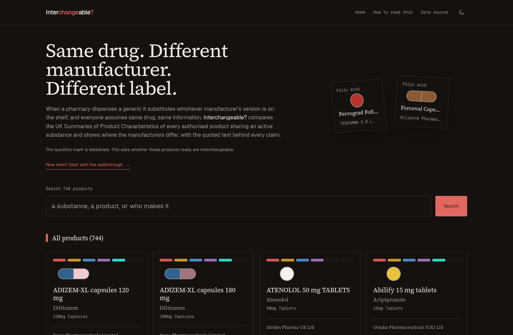
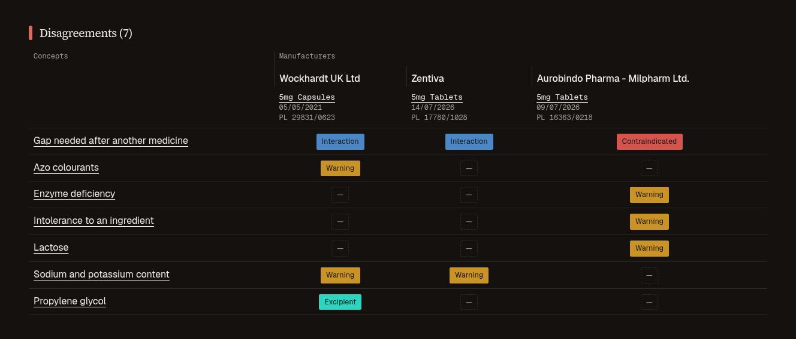
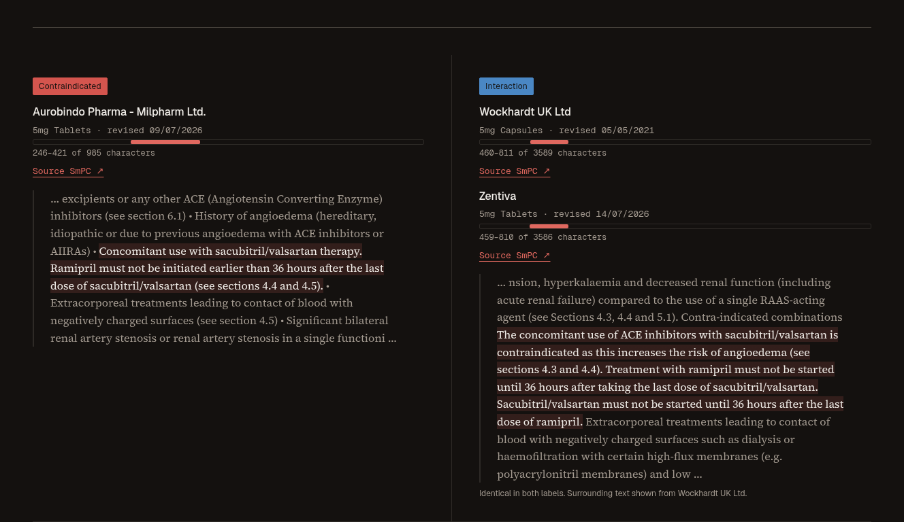
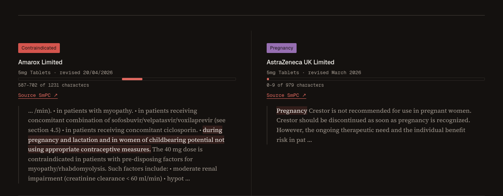
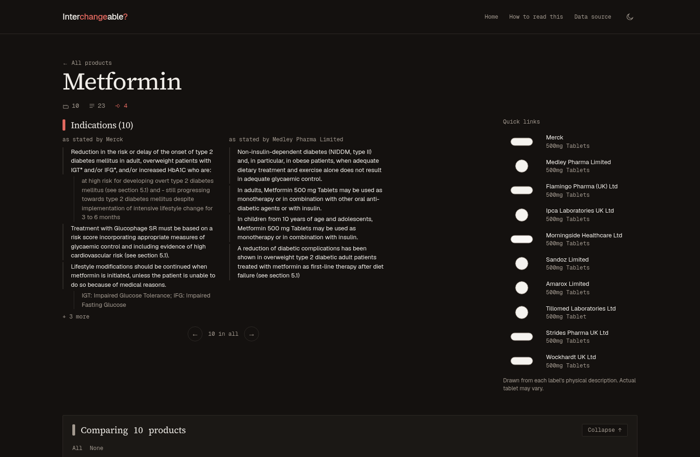
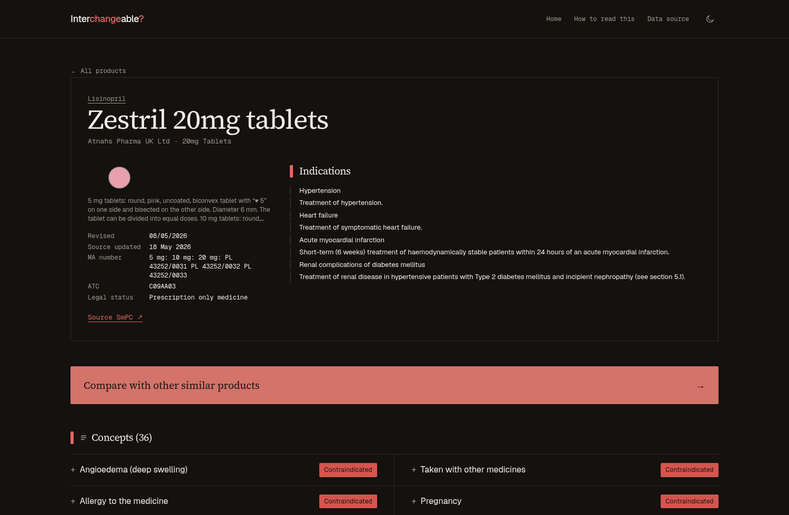
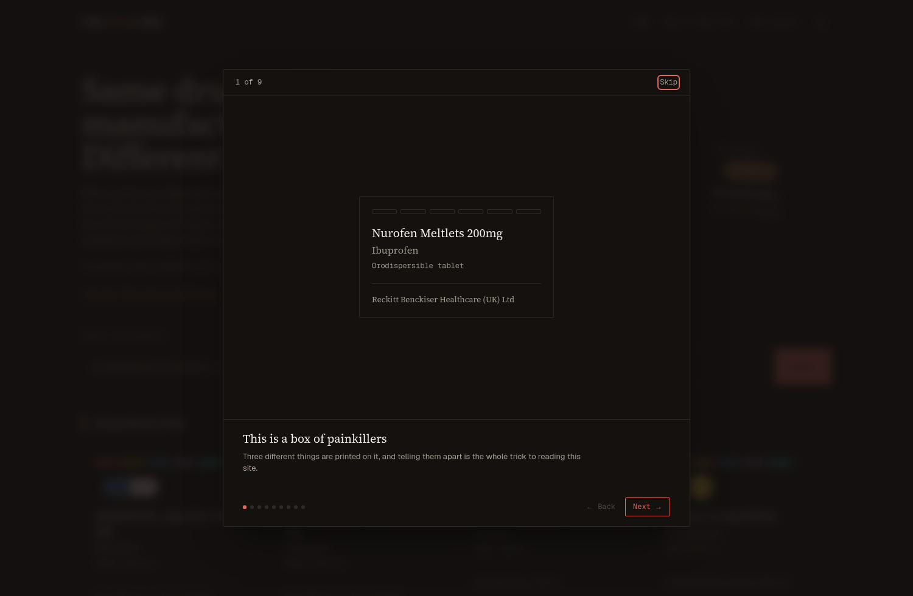
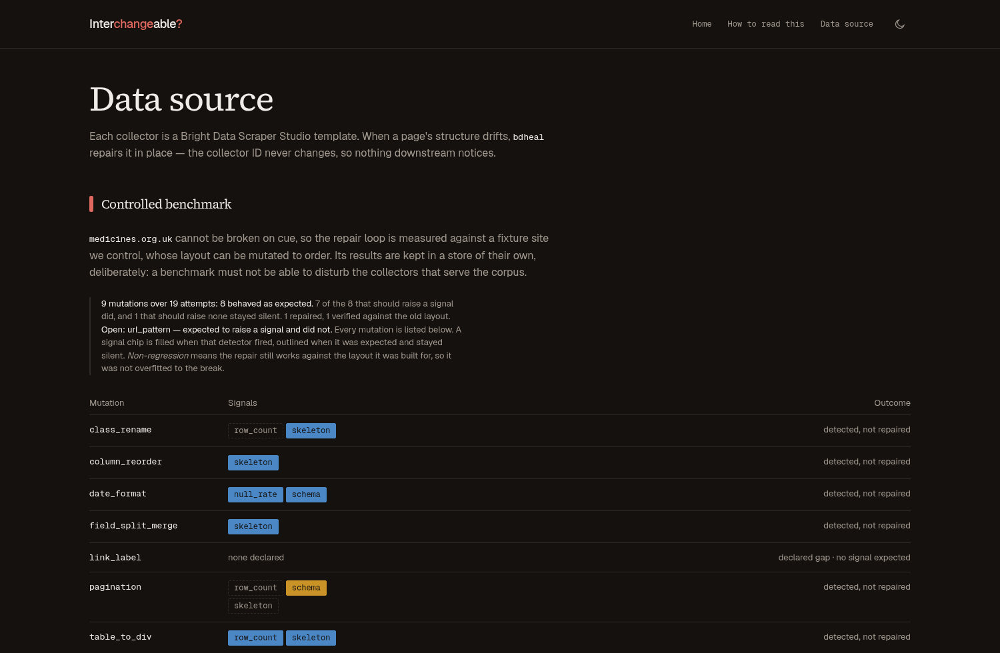

# Interchangeable?

**Same drug. Different manufacturer. Different label.**



When a pharmacy dispenses a generic, it substitutes whichever manufacturer's version is on
the shelf, and everyone assumes same drug, same information.

**Interchangeable?** compares the UK Summaries of Product Characteristics of every
authorised product that shares an active substance, and shows where the manufacturers
disagree — with the quoted text behind every claim.

The question mark is deliberate. It asks whether these products really are
interchangeable. It does not claim that they are not.

**80 substances · 744 labels · 1,007 disagreements.** Every substance collected so far has
at least one thing its manufacturers file differently.

---

## The finding

Fourteen ramipril products, from nine manufacturers. Every one of them states the same
clinical fact — do not start ramipril until 36 hours after the last dose of
sacubitril/valsartan. They do not agree how binding it is:

| Where the washout appears | Products |
|---|---|
| **§4.3 Contraindications** — an absolute bar | 7 — Milpharm, Brown & Burk, Sandoz, Zydus |
| §4.5 Interactions | 7 — Zentiva, Wockhardt, Rosemont, Sanofi, Roma |

A pharmacist reading one label sees a contraindication. Reading another, an interaction.
Same molecule, same requirement, different regulatory weight — and no label mentions that
the others file it elsewhere.



One row per concept, one column per manufacturer, one mark for where each label filed it.
Three of the fourteen labels are shown here, narrowed with the page's own filter.

Every cell opens onto the sentence that earned it:



The quote sits inside the text that surrounds it, with the matched span marked and its
character offsets named. Nothing is paraphrased and nothing is generated — the span is cut
from the stored section, so every claim can be checked against its source.

## A second finding

Ten rosuvastatin labels, all 5 mg tablets. Six file pregnancy under §4.3 as an absolute
contraindication, extending to *women of childbearing potential not using appropriate
contraceptive measures*. Four — including AstraZeneca's Crestor, the originator — place it
only in §4.6, where it reads *not recommended*, to be weighed against the ongoing
therapeutic need and the individual benefit risk.



These two labels were revised weeks apart in 2026, so one manufacturer lagging behind a
labelling update does not explain it. That is why `divergences` publishes each label's
revision date beside the finding: a one-sided result can be a stale label, and here it is
not.

## One substance



Ten metformin labels describe what the drug treats in ten different wordings — no two
identical. The page prints them side by side, attributed, and never merges them into a
house summary.

Beside them, every product is drawn: shape and colour parsed from the manufacturer's own
§3 description. No product photography exists for these labels anywhere, so each glyph is
a schematic and reads as one.

## One product



What the label carries, in the label's own words: its indications, its licence number, its
concepts and where each is filed. Two dates appear because the source page publishes two
that disagree, and both are shown rather than one being chosen.

## What it will not claim

- **Placement, never omission.** Absent from §4.3 does not mean absent from the label — it
  is often in §4.4 or §4.6. Every answer names the sections that were actually read.
- **Findings, not rates.** A rate needs a far larger run than this.
- **Nothing is dropped in silence.** A clause that matches no known concept is published as
  `unclassified`.

## A walkthrough, for readers who have never read a drug label



Nine steps, from a box of painkillers to a disagreement between six real labels. It runs
once on a first visit, and **How to read this** replays it.

## Self-healing collectors

Bright Data Scraper Studio collects the labels. When the structure of a page moves,
[`bdheal`](packages/bdheal) detects the break, names the signal, composes a repair, and
verifies it **against the old layout** to prove that it is not overfitted. The collector ID
never changes, so no downstream component is affected.



The project measures this against a fixture site that it can break on demand — nine
mutation classes, and it publishes the gaps rather than hides them.

## Run it

```bash
docker compose watch
```

- Web — http://localhost:3000
- API — http://localhost:8000 (`/health`, `/docs`)

## Ask it from an agent

The project exposes the comparison over MCP, so an assistant can answer a dispensing
question directly:

```bash
ixq-mcp                                  # stdio
POST https://<api-host>/mcp/             # streamable HTTP
```

| Tool | Question |
|---|---|
| `label_says(substance, concept)` | Does this manufacturer's label contraindicate X? |
| `divergences(substance)` | Where do these manufacturers disagree? |

## Documentation

| Document | Covers |
|---|---|
| [`docs/ARCHITECTURE.md`](docs/ARCHITECTURE.md) | The `bdheal` contract — layers, ports, detect semantics, the heal gate |
| [`docs/BRIGHT_DATA.md`](docs/BRIGHT_DATA.md) | The `bdata` CLI surface. Each warning cost a billable call |
| [`docs/GOLDEN_BENCHMARK.md`](docs/GOLDEN_BENCHMARK.md) | How the project measures self-healing |
| [`docs/DEPLOYMENT.md`](docs/DEPLOYMENT.md) | Deploying, and local development |
| [`AI_DISCLOSURE.md`](AI_DISCLOSURE.md) | Where the project used AI, and what the author directed |

## Status

Nothing here is ready for production. Nothing that it outputs is medical advice.

## Licence

MIT
